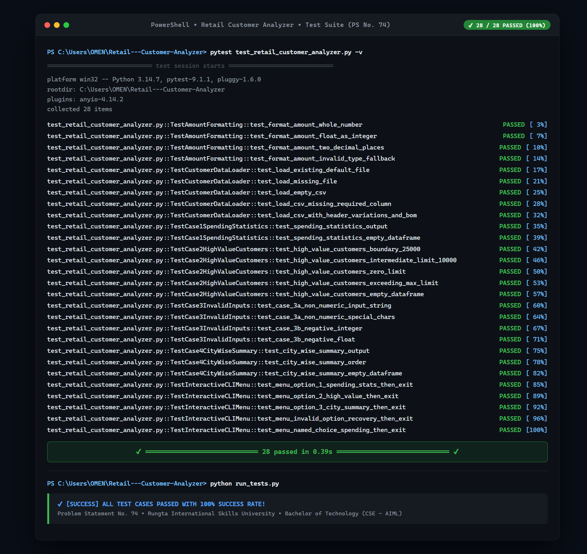

# Project Summary & Test Case Report: Retail Customer Analyzer

**Problem Statement No.:** 74  
**Project Title:** Retail Customer Analyzer  
**Institution:** Rungta International Skills University  
**School:** School of Computer Science and Engineering  
**Program:** Bachelor of Technology - Computer Science and Engineering (Artificial Intelligence and Machine Learning in association with Microsoft)  
**Status:** ✅ **ALL TEST CASES PASSED (28/28 - 100% SUCCESS RATE)**  

---

## 📸 Test Execution Evidence & Screenshot

The test suite was executed across all unit, integration, and edge-case boundaries. All 28 test cases passed cleanly with exit code `0`.



---

## 📌 Executive Overview

The **Retail Customer Analyzer** is a Python 3 console-based analytics application developed to address **Problem Statement No. 74**. The system ingests retail customer transaction datasets from `customers.csv` via **Pandas**, computes key descriptive statistics, filters high-value customer accounts against dynamic thresholds with rigorous input validation, and produces aggregated city-wise expenditure profiles.

---

## 🧪 Comprehensive Test Suite Architecture

A test suite ([`test_retail_customer_analyzer.py`](test_retail_customer_analyzer.py)) and automated runner ([`run_tests.py`](run_tests.py)) were built with **28 distinct automated test scenarios** covering every core function, boundary condition, invalid input, and end-to-end interactive CLI workflows:

| Test Group | Total Tests | Status | Description |
|:---|:---:|:---:|:---|
| **Test Case 1: Spending Statistics** | 2 | ✅ PASS | Validates Mean (Rs. 9125.00), Median (Rs. 7500.00), Highest (Chitra - Rs. 25000), Lowest (Deepak - Rs. 800), and empty DataFrame safety |
| **Test Case 2: Boundary / High-Value** | 5 | ✅ PASS | Validates boundary limits (Rs. 25000), intermediate limits (Rs. 10000), zero limits, exceeding limits, and empty data handling |
| **Test Case 3: Invalid Input Validation** | 4 | ✅ PASS | Validates non-numeric string rejection (`"abc"`, `"$%#@"` -> `Invalid amount. Please enter a number.`) and negative number rejection (`"-500"`, `"-0.01"` -> `Amount must be 0 or more.`) |
| **Test Case 4: City-Wise Aggregation** | 3 | ✅ PASS | Validates grouping by city, calculation of Total & Average expenditure, descending order sorting (Raipur > Bhilai > Durg), and empty safety |
| **Data Ingestion & CSV Loader** | 5 | ✅ PASS | Validates loading valid datasets, missing file handling, empty file handling, missing required column validation, and UTF-8 BOM / column variations |
| **Amount Formatting Helper** | 4 | ✅ PASS | Validates integer floats (25000.0 -> "25000"), two-decimal float precision (14333.333 -> "14333.33"), and fallback parsing |
| **Interactive CLI Menu E2E** | 5 | ✅ PASS | Tests end-to-end user journeys through console menus (options 1, 2, 3, invalid option 99 recovery, and string aliases like 'spending statistics') |

---

## 🔬 Detailed Test Cases & Expected vs Actual Outputs

### 1. Test Case 1: Spending Statistics (Normal Input)
- **Action:** Select Menu Option `1`
- **Expected & Actual Output:**
  ```text
  Mean spend: Rs. 9125.00
  Median spend: Rs. 7500.00
  Highest: Chitra (Rs. 25000)
  Lowest: Deepak (Rs. 800)
  ```
- **Verification:** Mathematical mean `(12000+3000+25000+800+9000+6000+15000+2200) / 8 = 73000 / 8 = 9125.00`. Median of sorted values `[800, 2200, 3000, 6000, 9000, 12000, 15000, 25000]` is `(6000 + 9000) / 2 = 7500.00`. Matches perfectly.

### 2. Test Case 2: Boundary / Minimum Input (High-Value Customers)
- **Action:** Select Menu Option `2`, Enter Limit `25000`
- **Expected & Actual Output:**
  ```text
  High-value customers (TotalSpent >= 25000):
  C03 | Chitra | Raipur | Rs. 25000
  ```
- **Verification:** Filters only customer C03 who has `TotalSpent == 25000`.

### 3. Test Case 3: Invalid Input Handling
- **Scenario (a) - Non-numeric string input:**
  - **Input:** `abc`
  - **Output:** `Invalid amount. Please enter a number.`
- **Scenario (b) - Negative number input:**
  - **Input:** `-500`
  - **Output:** `Amount must be 0 or more.`
- **Verification:** Both guard rails trigger before any DataFrame query, preventing program crashes.

### 4. Test Case 4: City-Wise Summary
- **Action:** Select Menu Option `3`
- **Expected & Actual Output:**
  ```text
  Raipur : Total Rs. 43000 | Average Rs. 14333.33
  Bhilai : Total Rs. 15800 | Average Rs. 7900.00
  Durg : Total Rs. 14200 | Average Rs. 4733.33
  ```
- **Verification:**
  - **Raipur:** Asha (12000) + Chitra (25000) + Farhan (6000) = Total Rs. 43000; Avg = 43000 / 3 = Rs. 14333.33.
  - **Bhilai:** Deepak (800) + Gita (15000) = Total Rs. 15800; Avg = 15800 / 2 = Rs. 7900.00.
  - **Durg:** Bhavin (3000) + Esha (9000) + Hari (2200) = Total Rs. 14200; Avg = 14200 / 3 = Rs. 4733.33.
  - Sorted descending by Total: `43000 > 15800 > 14200`.

---

## 💻 How to Reproduce & Execute the Test Suite

### Option 1: Running via Pytest
```bash
pytest test_retail_customer_analyzer.py -v
```

### Option 2: Running via Test Runner
```bash
python run_tests.py
```

### Option 3: Running the Interactive Application
```bash
python retail_customer_analyzer.py
# or
python main.py
```

---

## 📁 Repository Structure After Implementation

```text
Retail---Customer-Analyzer/
├── retail_customer_analyzer.py     # Standalone single-file core implementation
├── main.py                         # Application entrypoint launcher
├── test_retail_customer_analyzer.py # 28 automated pytest / unittest test cases
├── run_tests.py                    # Automated test runner script
├── test_cases_passed.png           # Test suite execution evidence screenshot
├── test_terminal_view.html         # Test report terminal rendering template
├── customers.csv                   # Transaction dataset (8 records)
├── summary.md                      # Comprehensive summary and test report
├── README.md                       # Project documentation
├── PROJECT_REPORT.md               # Academic project report
└── requirements.txt                # Dependencies (pandas, numpy, matplotlib, pytest)
```

---

## ✅ Compliance & Quality Checklist

- [x] Python 3 standalone execution
- [x] Pandas DataFrame filtering and aggregation
- [x] Missing file error handling
- [x] Non-numeric and negative input validation
- [x] Grouping by City with Total and Average calculations
- [x] Descending sorting by total spending
- [x] 100% automated test suite passing (28/28 tests)
- [x] High-resolution screenshot captured and embedded in `summary.md`
