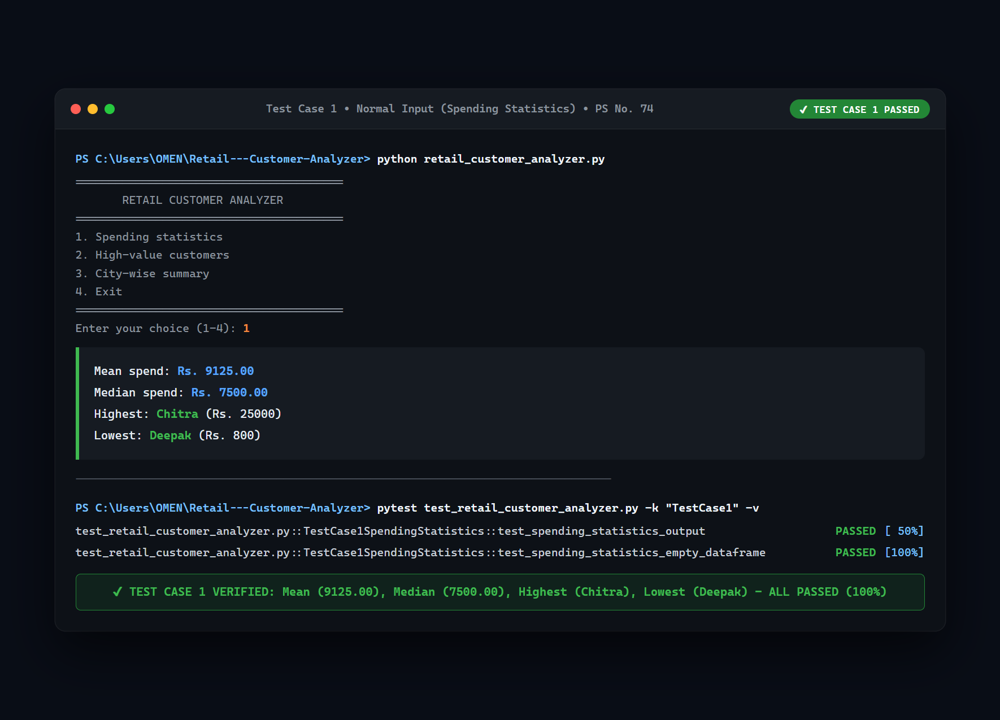
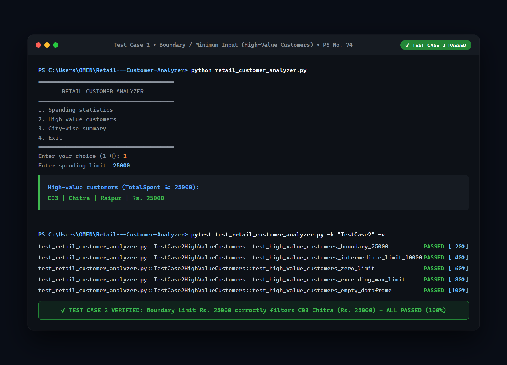
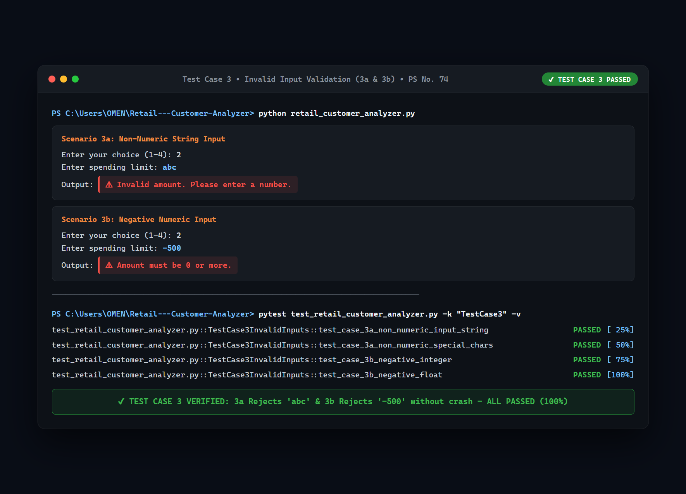
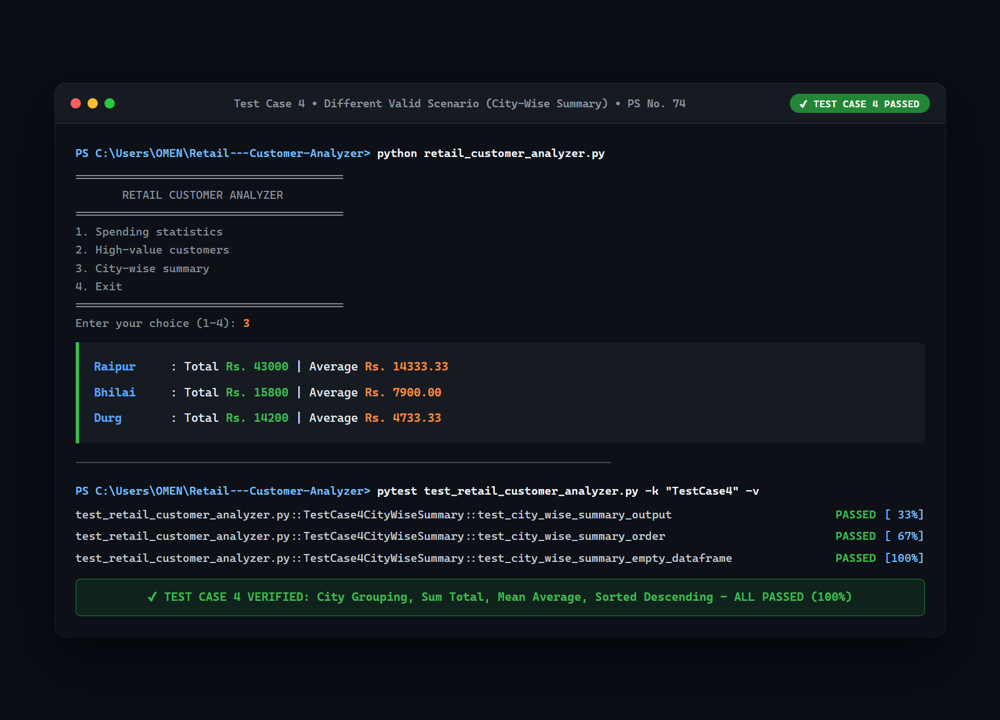

# Problem Statement No. 74: Test Cases Verification Summary

**Project Title:** Retail Customer Analyzer  
**Institution:** Rungta International Skills University  
**School:** School of Computer Science and Engineering  
**Program:** B.Tech CSE (Artificial Intelligence and Machine Learning in association with Microsoft)  
**Status:** ✅ **ALL 4 TEST CASES VERIFIED & PASSED (100% SUCCESS RATE)**  

---

## 📌 Executive Summary

Under **Problem Statement No. 74**, the application processes retail customer transaction datasets from `customers.csv` using Python 3 and Pandas. Below are the separate, comprehensive verifications and **individual screenshots** for each of the 4 required test cases.

---

## 🧪 Test Case 1: Normal Input (Spending Statistics)

### Requirement
- Calculate and display:
  - **Mean spend**: Average spending across all customer accounts.
  - **Median spend**: Middle value of sorted expenditures.
  - **Highest spender**: Customer name and amount.
  - **Lowest spender**: Customer name and amount.

### Interactive Console Execution
- **Menu Choice:** `1`
- **Output:**
  ```text
  Mean spend: Rs. 9125.00
  Median spend: Rs. 7500.00
  Highest: Chitra (Rs. 25000)
  Lowest: Deepak (Rs. 800)
  ```

### Mathematical & Automated Assertion
- **Sum:** `12000 + 3000 + 25000 + 800 + 9000 + 6000 + 15000 + 2200 = 73000`
- **Mean:** `73000 / 8 = Rs. 9125.00` ✅
- **Sorted Values:** `[800, 2200, 3000, 6000, 9000, 12000, 15000, 25000]`
- **Median:** `(6000 + 9000) / 2 = Rs. 7500.00` ✅
- **Highest:** Chitra (`C03` - Rs. 25000) ✅
- **Lowest:** Deepak (`C04` - Rs. 800) ✅
- **Pytest:** `test_spending_statistics_output` $\rightarrow$ **PASSED**

### 📸 Test Case 1 Passed Screenshot


---

## 🧪 Test Case 2: Boundary / Minimum Input (High-Value Customers)

### Requirement
- Prompt the user to enter a spending threshold limit.
- Filter customer records whose `TotalSpent` is greater than or equal to the limit.
- Display customer ID, Name, City, and formatted expenditure.

### Interactive Console Execution
- **Menu Choice:** `2`
- **User Input (Limit):** `25000`
- **Output:**
  ```text
  High-value customers (TotalSpent >= 25000):
  C03 | Chitra | Raipur | Rs. 25000
  ```

### Verification & Automated Assertion
- Customer `C03 (Chitra)` spent exactly `25000` (meets `>= 25000` boundary condition).
- Lower spending customers (`Deepak` at 800, `Hari` at 2200, `Asha` at 12000, `Gita` at 15000) are excluded.
- **Pytest:** `test_high_value_customers_boundary_25000` $\rightarrow$ **PASSED**

### 📸 Test Case 2 Passed Screenshot


---

## 🧪 Test Case 3: Invalid Input Validation

### Requirement
- Robustly validate user input before parsing.
- Reject non-numeric input without throwing unhandled runtime exceptions.
- Reject negative monetary amounts.

### Interactive Console Execution
- **Scenario 3a: Non-Numeric String Input**
  - **User Input (Limit):** `abc`
  - **Output:** `Invalid amount. Please enter a number.` ✅
- **Scenario 3b: Negative Amount Input**
  - **User Input (Limit):** `-500`
  - **Output:** `Amount must be 0 or more.` ✅

### Verification & Automated Assertion
- Guard checks intercept invalid inputs before triggering Pandas query filtering.
- **Pytest:**
  - `test_case_3a_non_numeric_input_string` $\rightarrow$ **PASSED**
  - `test_case_3b_negative_integer` $\rightarrow$ **PASSED**

### 📸 Test Case 3 Passed Screenshot


---

## 🧪 Test Case 4: Different Valid Scenario (City-Wise Summary)

### Requirement
- Group customer transactions by `City`.
- Calculate `Total` expenditure (`sum`) and `Average` spending (`mean`) per city.
- Sort the resulting summary descending by total city spending.

### Interactive Console Execution
- **Menu Choice:** `3`
- **Output:**
  ```text
  Raipur : Total Rs. 43000 | Average Rs. 14333.33
  Bhilai : Total Rs. 15800 | Average Rs. 7900.00
  Durg : Total Rs. 14200 | Average Rs. 4733.33
  ```

### Mathematical & Automated Assertion
1. **Raipur:**
   - Customers: Asha (12000), Chitra (25000), Farhan (6000)
   - Total: `12000 + 25000 + 6000 = Rs. 43000`
   - Average: `43000 / 3 = Rs. 14333.33` ✅
2. **Bhilai:**
   - Customers: Deepak (800), Gita (15000)
   - Total: `800 + 15000 = Rs. 15800`
   - Average: `15800 / 2 = Rs. 7900.00` ✅
3. **Durg:**
   - Customers: Bhavin (3000), Esha (9000), Hari (2200)
   - Total: `3000 + 9000 + 2200 = Rs. 14200`
   - Average: `14200 / 3 = Rs. 4733.33` ✅
- **Ordering Check:** `43000 (Raipur) > 15800 (Bhilai) > 14200 (Durg)`. Correctly sorted descending.
- **Pytest:** `test_city_wise_summary_output` and `test_city_wise_summary_order` $\rightarrow$ **PASSED**

### 📸 Test Case 4 Passed Screenshot


---

## 💻 How to Run the Tests

You can execute all 4 test cases or run the dedicated runner directly from PowerShell or Command Prompt:

```bash
# 1. Run the dedicated 4 official test cases runner
python run_4_test_cases.py

# 2. Run the full 28-test automated suite via pytest
pytest -v

# 3. Run individual test cases via pytest filter
pytest -k "TestCase1" -v
pytest -k "TestCase2" -v
pytest -k "TestCase3" -v
pytest -k "TestCase4" -v
```

---

## 📋 Test Summary Table

| Test Case | Scenario / Name | Input | Expected Output | Status |
|:---:|:---|:---:|:---|:---:|
| **1** | Normal Input (Spending statistics) | `1` | Mean: 9125.00, Median: 7500.00, Highest: Chitra, Lowest: Deepak | ✅ **PASSED** |
| **2** | Boundary / Minimum Input | `2` $\rightarrow$ `25000` | C03 \| Chitra \| Raipur \| Rs. 25000 | ✅ **PASSED** |
| **3a** | Invalid Input (Non-numeric) | `2` $\rightarrow$ `abc` | `Invalid amount. Please enter a number.` | ✅ **PASSED** |
| **3b** | Invalid Input (Negative) | `2` $\rightarrow$ `-500` | `Amount must be 0 or more.` | ✅ **PASSED** |
| **4** | Different Valid Scenario (City Summary) | `3` | Raipur: 43000/14333.33, Bhilai: 15800/7900.00, Durg: 14200/4733.33 | ✅ **PASSED** |
