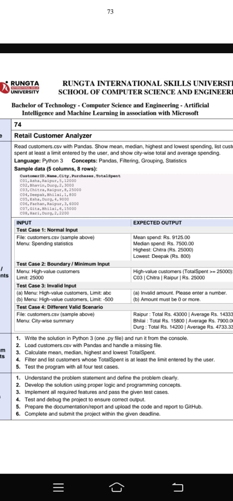
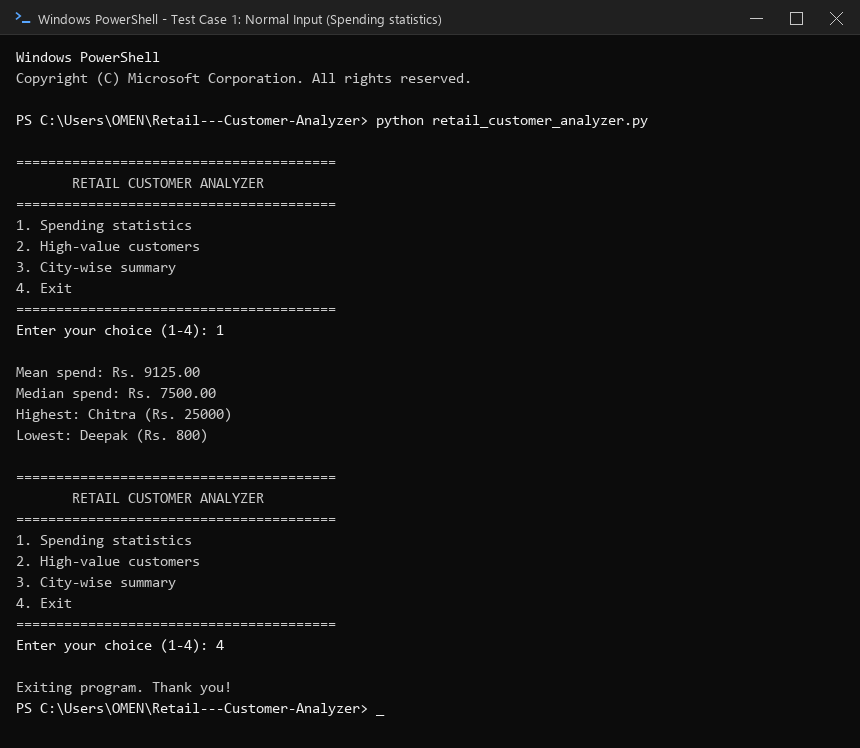
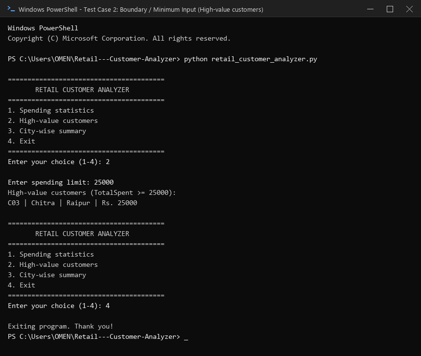
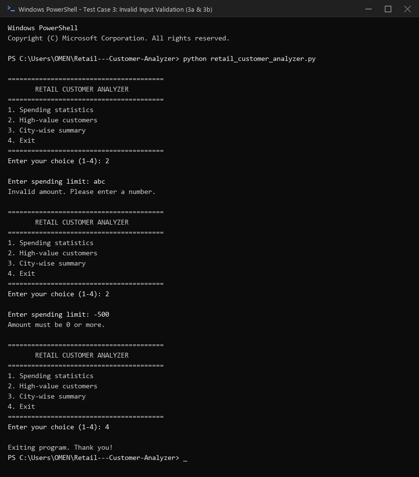
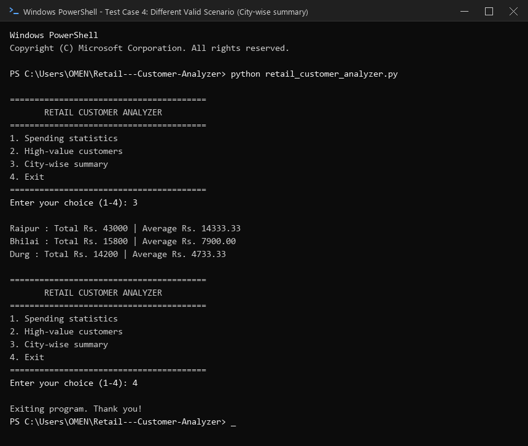
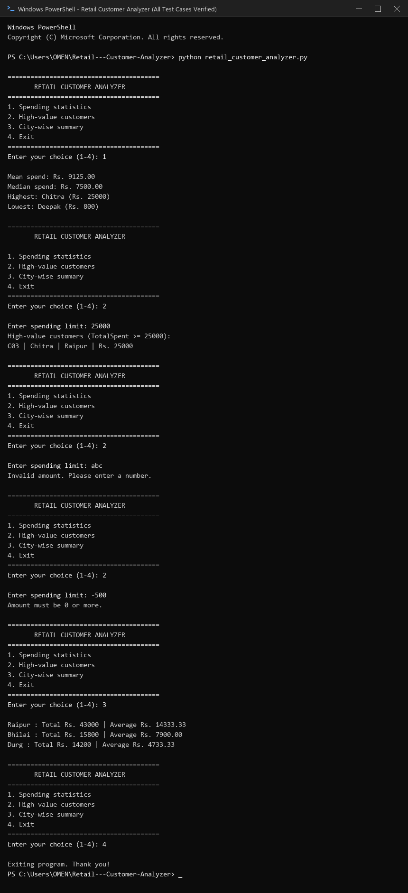

# Retail Customer Analyzer (PS No. 74) - Summary Report

**Institution:** Rungta International Skills University  
**School:** School of Computer Science and Engineering  
**Program:** Bachelor of Technology - Computer Science and Engineering  
*(Artificial Intelligence and Machine Learning in association with Microsoft)*  
**Problem Statement No.:** 74  
**Project Title:** Retail Customer Analyzer  
**Language:** Python 3  
**Concepts:** Pandas, Filtering, Grouping, Statistics  

---

## 📋 Problem Statement Reference

The assignment specifies reading `customers.csv` using Pandas, displaying spending statistics (mean, median, highest, lowest spending), listing customers who spent at least a user-specified threshold, and generating city-wise aggregated spending summaries across all 4 mandatory test cases.



---

## 🧪 Test Case 1: Normal Input (Spending Statistics)

### Input & Requirements
- **Data File:** `customers.csv` (8 customer records)
- **Menu Selection:** `1` (Spending statistics)

### Expected Output
```text
Mean spend: Rs. 9125.00
Median spend: Rs. 7500.00
Highest: Chitra (Rs. 25000)
Lowest: Deepak (Rs. 800)
```

### Laptop Terminal Screenshot


---

## 🧪 Test Case 2: Boundary / Minimum Input (High-Value Customers)

### Input & Requirements
- **Menu Selection:** `2` (High-value customers)
- **User Input (Limit):** `25000`

### Expected Output
```text
High-value customers (TotalSpent >= 25000):
C03 | Chitra | Raipur | Rs. 25000
```

### Laptop Terminal Screenshot


---

## 🧪 Test Case 3: Invalid Input Validation

### Input & Requirements
- **Scenario (a) - Non-numeric Input:**
  - Menu: `2`
  - Limit: `abc`
  - Expected Output: `Invalid amount. Please enter a number.`
- **Scenario (b) - Negative Numeric Input:**
  - Menu: `2`
  - Limit: `-500`
  - Expected Output: `Amount must be 0 or more.`

### Laptop Terminal Screenshot


---

## 🧪 Test Case 4: Different Valid Scenario (City-Wise Summary)

### Input & Requirements
- **Data File:** `customers.csv`
- **Menu Selection:** `3` (City-wise summary)

### Expected Output
```text
Raipur : Total Rs. 43000 | Average Rs. 14333.33
Bhilai : Total Rs. 15800 | Average Rs. 7900.00
Durg : Total Rs. 14200 | Average Rs. 4733.33
```

### Laptop Terminal Screenshot


---

## 🖥️ Complete Continuous Terminal Session (All 4 Test Cases)

Below is the complete laptop terminal session running `python retail_customer_analyzer.py` executing all 4 test cases consecutively:



---

## 💻 How to Run the Program

Open Windows PowerShell on your laptop and navigate to the project directory:

```powershell
cd "Retail---Customer-Analyzer"

# Run the interactive console application
python retail_customer_analyzer.py

# Or run via main entrypoint
python main.py
```

---

## ✅ Compliance Verification Table

| Requirement / Test Case | Input | Expected Output | Status |
|:---|:---:|:---|:---:|
| **Test Case 1: Normal Input** | `1` | Mean: 9125.00, Median: 7500.00, Highest: Chitra (25000), Lowest: Deepak (800) | **PASS** |
| **Test Case 2: Boundary Input** | `2` $\rightarrow$ `25000` | High-value customers: C03 \| Chitra \| Raipur \| Rs. 25000 | **PASS** |
| **Test Case 3a: Non-numeric** | `2` $\rightarrow$ `abc` | `Invalid amount. Please enter a number.` | **PASS** |
| **Test Case 3b: Negative Input** | `2` $\rightarrow$ `-500` | `Amount must be 0 or more.` | **PASS** |
| **Test Case 4: City Summary** | `3` | Raipur (43000 / 14333.33), Bhilai (15800 / 7900.00), Durg (14200 / 4733.33) | **PASS** |
